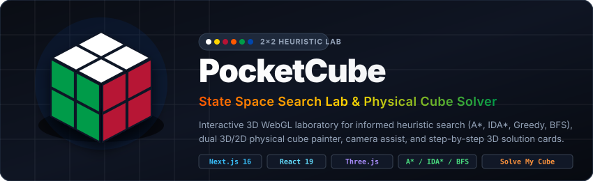
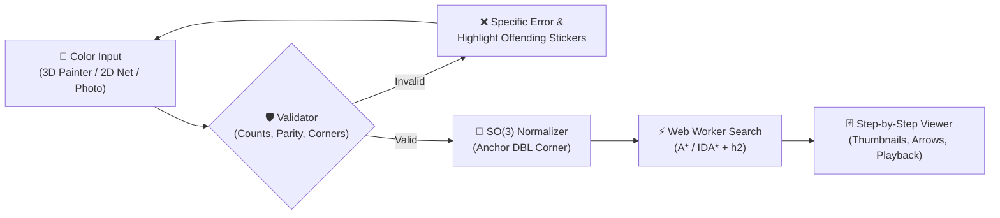
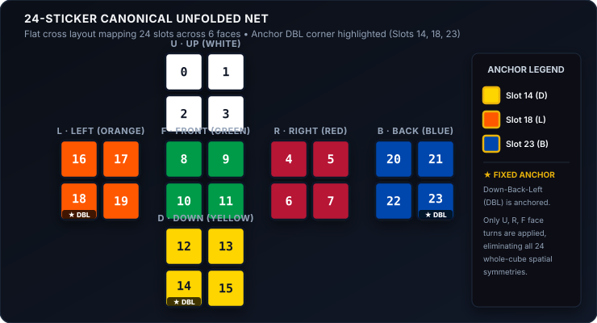
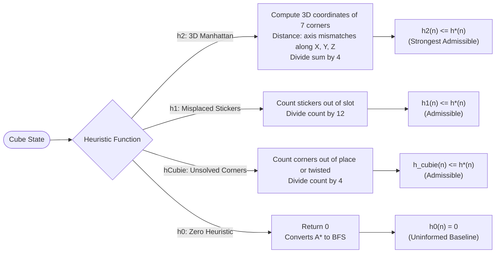
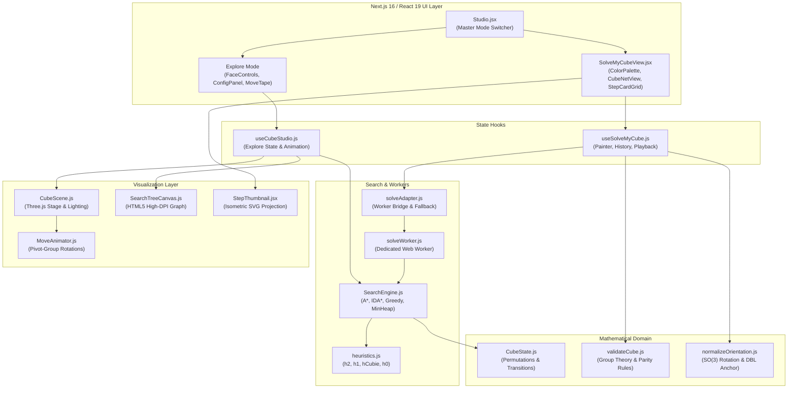

<div align="center">



<p align="center">
  <b>A high-performance 3D WebGL laboratory, heuristic search visualizer, and physical solver for the 2×2 Pocket Cube.</b><br/>
  Combines informed graph search algorithms (<b>A*</b>, <b>IDA*</b>, <b>Greedy Best-First</b>, and <b>BFS</b>) with real-time 3D Three.js rendering, an interactive 2D search tree canvas, and the <b>"Solve My Cube"</b> physical cube scanner and step-by-step 3D solver.
</p>

<p align="center">
  <a href="https://nextjs.org/"></a>
  <a href="https://react.dev/"></a>
  <a href="https://threejs.org/"></a>
  <a href="#-verification-test-gates"></a>
  <a href="https://nodejs.org/"></a>
  <a href="LICENSE"></a>
</p>

<p align="center">
  <a href="#quick-start"><b>Quick Start</b></a> •
  <a href="#highlights"><b>Highlights</b></a> •
  <a href="#solve-my-cube"><b>Solve My Cube</b></a> •
  <a href="#features"><b>Features</b></a> •
  <a href="#math"><b>Math</b></a> •
  <a href="#algorithms"><b>Algorithms</b></a> •
  <a href="#heuristics"><b>Heuristics</b></a> •
  <a href="#architecture"><b>Architecture</b></a> •
  <a href="#tests"><b>Tests</b></a> •
  <a href="#controls"><b>Controls</b></a>
</p>

</div>

<p align="center"></p>

<!-- TODO: Add docs/screenshot.png and docs/demo.gif showcasing Explore and Solve My Cube modes -->
<div align="center">
  <blockquote>
    <b>Interactive Studio Preview</b><br/>
    <i>Split-pane interface featuring real-time Three.js WebGL rendering, live HTML5 search-tree canvas, and step-by-step graphical cards.</i><br/>
    <!-- TODO: Place docs/screenshot.png here -->
  </blockquote>
</div>

<p align="center"></p>

<a id="highlights"></a>
## 🟥 Highlights

<table>
  <tr>
    <td width="50%">
      <b>🎮 Interactive 3D WebGL Studio</b><br/>
      Photorealistic 2×2 Pocket Cube built with Three.js, complete with studio lighting, micro-beveled cubies, glossy decals, and drift-free pivot-group rotation mechanics.
    </td>
    <td width="50%">
      <b>🧩 "Solve My Cube" Physical Solver</b><br/>
      Paint your own physical cube in 3D or on a 2D cross net (with optional webcam/photo assist), validate physical feasibility, and step through graphical 3D cards.
    </td>
  </tr>
  <tr>
    <td width="50%">
      <b>🧠 Informed Heuristic Search</b><br/>
      Real-time execution of <b>A*</b>, <b>IDA*</b>, <b>Greedy Best-First</b>, and <b>BFS</b> across 3.67M reachable configurations with admissible heuristics ($h_2$, $h_1$, $h_0$).
    </td>
    <td width="50%">
      <b>🌳 Live 2D Search-Tree Graph</b><br/>
      High-DPI Canvas graph visualizing node expansions, frontiers, and solution paths in real time with interactive click-to-preview 3D state inspection.
    </td>
  </tr>
  <tr>
    <td width="50%">
      <b>⚡ Non-Blocking Telemetry Web Worker</b><br/>
      Asynchronous Web Worker and ES6 generator architecture emits node-by-node search metrics without freezing the browser's UI thread.
    </td>
    <td width="50%">
      <b>📐 Group Theory &amp; Symmetry Reduction</b><br/>
      Pins the Down-Back-Left (DBL) corner piece to eliminate whole-cube rotational symmetries, pruning branching factor and guaranteeing canonical state representations.
    </td>
  </tr>
</table>

<p align="center"></p>

<a id="quick-start"></a>
## ⬜ Quick Start

### Prerequisites
* **Node.js** `v18.17.0` or higher (`v20+` recommended)
* **npm** `v9.0.0` or higher

```bash
# 1. Clone the repository
git clone https://github.com/sarthakroutray/RubiksCubeSolver.git
cd RubiksCubeSolver

# 2. Install dependencies
npm install

# 3. Launch local development server
npm run dev
```

Open your browser and navigate to **`http://localhost:3000`**.

### Production Build

```bash
# Compile optimized Next.js bundle
npm run build

# Start production server
npm run start
```

<p align="center"></p>

<a id="solve-my-cube"></a>
## 🟧 Solve My Cube

The **"Solve My Cube"** feature bridges physical cubes with the heuristic search lab. Users enter the colors of their physical 2×2 cube, and the engine validates physical feasibility, normalizes spatial orientation, computes an optimal solution via a Web Worker, and displays graphical step-by-step 3D playback cards.



### How to Use

1. **Switch Mode**: Click **"Solve My Cube"** at the top of the left stage pane.
2. **Paint Your Cube**:
   * **3D Painter**: Click any palette color (White, Yellow, Red, Orange, Green, Blue) and click directly on the 3D cube stickers. Freely drag to orbit and rotate the cube.
   * **2D Unfolded Net**: Paint or click-and-drag across the cross net view. Stays synchronized with the 3D model.
   * **Photo / Camera Assist**: Click **"📷 Photo Assist"** to capture faces via webcam or file uploads. Automatic HSV color classification auto-populates the 4 quadrants per face with manual review before applying.
   * **Color-Blind Mode**: Click **"Letters ON"** to display `W`, `Y`, `R`, `O`, `G`, `B` labels on stickers.
3. **Validate & Solve**:
   * The validation engine continuously verifies state validity in real time. If invalid, the offending stickers pulse red and clear diagnostic feedback is provided.
   * Select your search algorithm (**A\*** or **IDA\***) and heuristic (**$h_2$ Manhattan** or **$h_1$ Stickers**).
   * Click **"⚡ Solve My Cube"**. The search executes in a non-blocking background Web Worker.
4. **Step-By-Step 3D Viewer**:
   * **Graphical Step Cards**: Each card displays the move notation (e.g. `R`, `U'`, `F2`), plain-English caption (*"Turn the Right face clockwise 90°"*), and an isometric vector thumbnail with a directional arrow.
   * **Playback Bar**: Play/Pause (<kbd>Space</kbd>), Next (<kbd>→</kbd>), Prev (<kbd>←</kbd>), Restart, scrubber slider, and speed control (0.5× to 5×).
   * **Step-by-Step (Manual) Mode**: Waits for you to replicate each turn on your physical cube before advancing.
   * **Hold Your Cube Hint**: Clear spatial alignment banner (*"White on Top, Green in Front, Red on Right"*).
   * **Beginner Breakdown**: Groups optimal moves into 3 instructional phases (*Phase 1: Base Layer*, *Phase 2: Top Orientation OLL*, *Phase 3: Corner Permutation PLL*).
   * **Verification Replay**: When solved, verify your cube with the interactive replay mode.

### Validation Rules Matrix

The validator ([`src/solve-my-cube/validation/validateCube.js`](file:///C:/Users/OM%20WATTAMWAR/Downloads/RubiksCubeSolver/src/solve-my-cube/validation/validateCube.js)) rigorously enforces 8 physical laws of the Rubik's cube group:

| Validation Rule | Mathematical Constraint | Example Error Message |
| :--- | :--- | :--- |
| **Completeness** | All 24 slots assigned | `"6 stickers left to paint."` |
| **Color Multiplicity** | Exactly 4 of each of the 6 colors | `"Each color must appear exactly 4 times (White: 5/4, Red: 3/4)."` |
| **Opposite Face Feasibility** | Two colors are opposite iff they never share a corner cubie | `"Invalid corner: White-Yellow-Red contains incompatible opposite colors."` |
| **Corner Uniqueness** | All 8 corners must match distinct canonical triplets | `"Duplicate corner: A White-Green-Red corner appears more than once."` |
| **Corner Chirality** | Clockwise sticker order around corner must be right-handed | `"Impossible corner: White-Red-Green is physically mirrored (wrong chirality)."` |
| **Orientation Twist Parity** | $\sum_{i=0}^7 \text{twist}(i) \equiv 0 \pmod 3$ | `"Corner twist parity error: One or more corners have been physically twisted."` |
| **Orientation Normalization** | Rotation matrix $M \in SO(3)$ maps DBL corner to fixed anchor | `"Could not find a valid cube reference orientation."` |
| **Goal Verification** | Canonical state matches solved identity | `"Cube state is already solved! No moves needed."` |

<p align="center"></p>

<a id="features"></a>
## 🟨 Key Features

| Feature | Description |
| :--- | :--- |
| **Interactive 3D Stage** | OrbitControls with free rotation, panning, smooth zoom, and one-click camera angle presets (**Iso**, **Front**, **Top**, **Right**). |
| **Face Controls** | Quick manual buttons for Clockwise (90°), Counter-Clockwise (-90°), and Half Turns (180°) on the three active faces: **U**, **R**, and **F**. |
| **Scramble Engine** | Instant scrambles for 4, 7, or 10 moves, +5 / +10 move extensions, or custom Singmaster notation input (e.g. `U R2 F' U' R`). |
| **Search Tree Canvas** | Layered hierarchy displaying expanded closed-set nodes, open frontier nodes, current search head, and final optimal solution path. |
| **Live Telemetry Cards** | Real-time tracking of Expanded Nodes ($|closed|$), Frontier Nodes ($|open|$), Depth $g(n)$, Heuristic $h(n)$, Priority $f(n)$, and Effective Branching Factor ($b^* = N^{1/d}$). |
| **Interactive Move Tape** | Ribbon sequence of the computed solution. Click any move chip to step through and preview the intermediate cube state in 3D. |
| **Speed Controller** | Adjustable search and animation playback rate from **0.25×** (slow-motion step inspection) up to **10×** (high-speed expansion). |
| **Dual Modes** | Seamless switching between **Explore Mode** (unconstrained state experimentation) and **Solve My Cube Mode** (physical cube color input and step playback). |

<p align="center"></p>

<a id="math"></a>
## 🟩 Mathematical Formulation

The 2×2×2 Rubik's Cube (Pocket Cube) is composed of 8 corner cubies with no edge or center pieces. Each cubie exposes 3 colored stickers, totaling $8 \times 3 = 24$ visible facets.

### State-Space Complexity

* **Permutations:** 8 corner positions can be permuted in $8! = 40,320$ ways.
* **Orientations:** Each corner has 3 possible orientations ($0^\circ, 120^\circ, 240^\circ$). The orientation of the final piece is determined by the remaining 7, yielding $3^7 = 2,187$ orientations.
* **Physical Reachable States:**
  $$\frac{8! \times 3^7}{24} = 7! \times 3^6 = 3,674,160 \text{ states}$$
* **God's Number:**
  * **Half-Turn Metric (HTM):** **11 moves** maximum for any solvable configuration.
  * **Quarter-Turn Metric (QTM):** **14 moves** maximum.

### Symmetry Reduction (The Fixed DBL Corner)

In an unconstrained cube, whole-cube rotations (rotational symmetries of the octahedral group $O$, order 24) generate duplicate states that represent identical physical configurations viewed from different angles.

To eliminate this redundancy without requiring quotient-space graph hashing:
1. The **Down-Back-Left (DBL)** corner piece (Index 7) is locked in space.
2. Moves are strictly restricted to the 3 faces opposite and adjacent to DBL:
   $$\text{Action Space } \mathcal{A} = \{ \text{U, U', U2, R, R', R2, F, F', F2} \}$$
3. Restricting turning faces to **Up (U)**, **Right (R)**, and **Front (F)** guarantees that the DBL corner never moves.
4. This locks spatial orientation, slashes the branching factor from 18 to 9 (or 6 non-repeating), and ensures every state has a unique canonical representation.

<div align="center">
  
</div>

### 24-Sticker Slot Indexing Table

| Face ID | Face Name | Color | Solved Slot Indices | Fixed Corner Anchor |
| :---: | :--- | :---: | :---: | :---: |
| `0` | ⬜ **U** (Up) | White (`#f8fafc`) | `[0, 1, 2, 3]` | — |
| `1` | 🟥 **R** (Right) | Red (`#ef4444`) | `[4, 5, 6, 7]` | — |
| `2` | 🟩 **F** (Front) | Green (`#22c55e`) | `[8, 9, 10, 11]` | — |
| `3` | 🟨 **D** (Down) | Yellow (`#facc15`) | `[12, 13, 14, 15]` | Slot 14 (D) |
| `4` | 🟧 **L** (Left) | Orange (`#f97316`) | `[16, 17, 18, 19]` | Slot 18 (L) |
| `5` | 🟦 **B** (Back) | Blue (`#3b82f6`) | `[20, 21, 22, 23]` | Slot 23 (B) |

### Corner Cubie Triplets

The 8 corner cubies correspond to ordered sticker index triplets:
- `0 (UFL)`: `[2, 8, 17]`
- `1 (UFR)`: `[3, 9, 4]`
- `2 (UBR)`: `[1, 5, 20]`
- `3 (UBL)`: `[0, 21, 16]`
- `4 (DFL)`: `[12, 19, 10]`
- `5 (DFR)`: `[13, 11, 6]`
- `6 (DBR)`: `[15, 7, 22]`
- **`7 (DBL)`**: `[14, 23, 18]` *(Fixed anchor — never moves under U, R, F)*

### Permutation Cycles

State transitions are computed via precomputed cyclic permutations in [`src/core/constants.js`](file:///C:/Users/OM%20WATTAMWAR/Downloads/RubiksCubeSolver/src/core/constants.js):
* **`U` (CW quarter turn):** `[[0, 1, 3, 2], [8, 16, 20, 4], [17, 21, 5, 9]]`
* **`R` (CW quarter turn):** `[[4, 5, 7, 6], [3, 20, 15, 11], [9, 1, 22, 13]]`
* **`F` (CW quarter turn):** `[[8, 9, 11, 10], [2, 4, 13, 19], [3, 6, 12, 17]]`

Double turns (`U2`, `R2`, `F2`) compose the permutation twice; inverse turns (`U'`, `R'`, `F'`) compose it three times. Transition application takes $O(24)$ operations using typed arrays with zero heap allocation.

<p align="center"></p>

<a id="algorithms"></a>
## 🟦 Search Algorithms


### 1. A* Search (Optimal Graph Search)
* **Evaluation Function:**
  $$f(n) = g(n) + h(n)$$
  where $g(n)$ is the exact path cost (move count from root) and $h(n)$ is an admissible heuristic estimate to the goal.
* **Data Structures:** Custom binary `MinHeap` ordered by $f(n)$ ascending (tie-broken by deeper $g(n)$ and lower $h(n)$), `Set<string>` closed set, and `Map<string, number>` $g$-score lookup.
* **Optimality:** Always finds the **strictly shortest (optimal) move sequence** when paired with an admissible heuristic.

### 2. IDA* (Iterative Deepening A*)
* **Mechanism:** Combines the linear memory efficiency of Depth-First Search with the optimality guarantees of A*.
* **Algorithm Flow:**
  1. Initializes threshold $T = h(\text{start})$.
  2. Traverses depth-first along active paths; prunes any branch where $f(n) = g(n) + h(n) > T$, recording the minimum exceeded value $\min f_{\text{exceeded}}$.
  3. Cycle detection along the path stack prevents infinite loops.
  4. If goal is not reached, updates $T \leftarrow \min f_{\text{exceeded}}$ and re-traverses.
* **Space Complexity:** $O(d)$ where $d$ is solution depth, bypassing the large heap footprint of standard A*.

### 3. Greedy Best-First Search
* **Evaluation Function:**
  $$f(n) = h(n)$$
* **Characteristics:** Prioritizes nodes estimated to be closest to the goal regardless of accumulated steps. Extremely fast exploration on simple scrambles, but **sacrifices optimality** (may produce longer move sequences with redundant loops).

### 4. Breadth-First Search (BFS / Uninformed Search)
* **Evaluation Function:**
  $$f(n) = g(n) + 0$$
* Implemented by selecting $h_0$ (Zero Heuristic). Expands states strictly layer-by-layer, demonstrating exponential node explosion without heuristic guidance.

### Algorithm Comparison Matrix

| Algorithm | Evaluation $f(n)$ | Space Complexity | Time Complexity | Optimality | Best Use Case |
| :--- | :---: | :---: | :---: | :---: | :--- |
| **A\*** | $g(n) + h(n)$ | $O(b^d)$ | $O(b^d)$ | **Guaranteed** | Optimal path benchmark; moderate depths |
| **IDA\*** | $g(n) + h(n) \le T$ | $O(d)$ | $O(b^d)$ | **Guaranteed** | Memory-constrained optimal search |
| **Greedy Best-FS** | $h(n)$ | $O(b^d)$ | $O(b^m)$ | Suboptimal | Rapid heuristic exploration |
| **BFS ($h_0$)** | $g(n)$ | $O(b^d)$ | $O(b^d)$ | **Guaranteed** | Uninformed baseline comparison |

<p align="center"></p>

<a id="heuristics"></a>
## ⬜ Heuristic Functions &amp; Admissibility Proofs

> [!NOTE]
> A heuristic $h(n)$ is **admissible** if it never overestimates the true cost $h^*(n)$ to reach the solved goal state:
> $$0 \le h(n) \le h^*(n) \quad \forall n$$



<details>
<summary><b>📐 1. 3D Manhattan Corner Distance ($h_2$) — Proof Inside</b></summary>

### Formulation
This is the primary and most informed admissible heuristic in the suite:
1. Each of the 7 movable corners maps to its solved home position index $p \in \{0, \dots, 6\}$.
2. Current coordinates $c_{\text{curr}} \in \{-1, +1\}^3$ and home coordinates $c_{\text{home}} \in \{-1, +1\}^3$ are compared across the three Cartesian axes.
3. The number of axis mismatches ($0, 1, 2, 3$) gives the minimum turns needed to reposition that single corner:
   $$\text{cost}(p) = \begin{cases} 0 & \text{if mismatches} = 0 \\ 1 & \text{if mismatches} \in \{1, 2\} \\ 2 & \text{if mismatches} = 3 \end{cases}$$
4. Dividing the sum of individual corner distances by 4 yields the heuristic value:
   $$h_2(n) = \frac{1}{4} \sum_{p=0}^6 \text{cost}(p)$$

### Admissibility Proof
Any single face turn ($90^\circ$ or $180^\circ$) affects at most **4 corner cubies** simultaneously. The remaining 4 corners (including fixed DBL) undergo zero displacement. Therefore, a single move can reduce the total coordinate mismatch distance sum by at most 4. Dividing the sum by 4 guarantees:
$$h_2(n) \le h^*(n) \quad \forall n$$
Hence, $h_2$ is strictly admissible and dominates $h_1$.
</details>

<details>
<summary><b>📐 2. Misplaced Sticker Heuristic ($h_1$) — Proof Inside</b></summary>

### Formulation
Counts the number of stickers out of 24 that do not match their target face color:
$$\text{misplaced}(n) = \sum_{i=0}^{23} [\text{state}[i] \ne \text{targetFace}[i]]$$
Dividing the misplaced count by 12 yields:
$$h_1(n) = \frac{\text{misplaced}(n)}{12}$$

### Admissibility Proof
A single face turn rotates 4 stickers on the turned face and cycles $2 \times 4 = 8$ adjacent side stickers, affecting at most **12 stickers** total. No single move can correct more than 12 stickers. Thus:
$$h_1(n) = \frac{\text{misplaced}(n)}{12} \le h^*(n) \quad \forall n$$
</details>

<details>
<summary><b>📐 3. Corner Position &amp; Twist Heuristic ($h_{\text{cubie}}$) — Proof Inside</b></summary>

### Formulation
Counts how many of the 7 movable corners are either in the wrong position slot or correctly positioned but twisted:
$$h_{\text{cubie}}(n) = \frac{\text{unsolvedCorners}(n)}{4}$$

### Admissibility Proof
Since each face turn changes the position or orientation of at most 4 corners, no single turn can solve more than 4 corners. Dividing by 4 yields an admissible lower bound.
</details>

<details>
<summary><b>📐 4. Zero Heuristic ($h_0$) — Uninformed Baseline</b></summary>

### Formulation
Returns constant zero:
$$h_0(n) = 0$$
Transforms A* into Dijkstra's Algorithm / Breadth-First Search. Serves as an academic baseline to visualize exponential node explosion without heuristic guidance.
</details>

<p align="center"></p>

<a id="architecture"></a>
## 🟥 Software Architecture

The application is structured into decoupled modules separating mathematical representation, solver execution, 3D WebGL rendering, 2D canvas visualization, and the physical cube solver:



### Generator-Based Telemetry Loop

The search engine in [`src/solver/SearchEngine.js`](file:///C:/Users/OM%20WATTAMWAR/Downloads/RubiksCubeSolver/src/solver/SearchEngine.js) is implemented as an ES6 **Generator Function**:

```javascript
export function* search(startState, options = {}) {
  // Yields telemetry frames at specified intervals:
  yield buildFrame(step++, algorithmId, current, open, closed.size, isGoal);
}
```

This yields search execution control back to the UI loop or Web Worker, enabling:
* **Instant Mode:** Executes synchronously without UI yielding, immediately computing the solution and animating playback.
* **Live Search Mode:** Throttles generator consumption (`yieldEvery`, `sleep(ms)`), dynamically rendering each expanded candidate node on both the 3D cube and the 2D tree graph.

### Three.js Pivot-Group Rotation Engine

To eliminate quaternion drift, numerical rounding errors, and gimbal lock over hundreds of animated face turns:
1. A temporary `pivot = new THREE.Group()` is attached at world origin `(0, 0, 0)`.
2. The 4 cubies on the turning layer (e.g. $y > 0.1$ for Up face) are attached into `pivot` using `pivot.attach(cubie)` (preserving world matrices).
3. The pivot is smoothly animated using cubic easing (`easeInOutCubic`).
4. On completion, cubies are reparented back to the scene using `scene.attach(cubie)`.
5. Exact lattice coordinates $(\pm0.52, \pm0.52, \pm0.52)$ and rotation angles ($\frac{k\pi}{2}$) are snapped to eliminate numerical drift.

<p align="center"></p>

<a id="repository-structure"></a>
## 🟧 Repository Structure

```text
RubiksCubeSolver/
├── assets/
│   ├── banner.svg             # Isometric 2x2 hero card with floating animation
│   ├── divider.svg            # Repeating 2x2 palette sticker divider ribbon
│   └── cube-net.svg           # 24-sticker canonical unfolded net with DBL anchor
│
├── src/
│   ├── app/
│   │   ├── layout.jsx         # HTML document shell, metadata, and fonts
│   │   └── page.jsx           # Entry route mounting the Studio component
│   │
│   ├── core/                  # Pure mathematical domain
│   │   ├── constants.js       # Face indices, color definitions, cycle tables
│   │   └── CubeState.js       # Permutation composition, moves, scramble generator
│   │
│   ├── solver/                # Heuristic search engine
│   │   ├── heuristics.js      # h2 (Manhattan), h1 (Misplaced), hCubie, h0 (BFS)
│   │   └── SearchEngine.js    # A*, IDA*, Greedy Best-FS, MinHeap, generators
│   │
│   ├── solve-my-cube/         # "Solve My Cube" custom physical cube solver
│   │   ├── constants.js       # Palette definitions, move captions, net layouts
│   │   ├── useSolveMyCube.js  # Master hook for painting, raycasting, solving
│   │   ├── SolveMyCubeView.jsx# Main Solve My Cube workspace component
│   │   ├── validation/
│   │   │   └── validateCube.js # Strict physical validity (counts, chirality, twist)
│   │   ├── conversion/
│   │   │   └── normalizeOrientation.js # 24 SO(3) rotations to DBL anchor
│   │   ├── solver-adapter/
│   │   │   ├── solveAdapter.js # Worker client bridge with fallback
│   │   │   ├── solveWorker.js  # Dedicated background Web Worker
│   │   │   └── beginnerMethod.js# Human-style 3-phase educational breakdown
│   │   ├── input/
│   │   │   ├── ColorPalette.jsx# 6-color swatch picker, counters, tools
│   │   │   ├── CubeNetView.jsx # 2D cross net with drag painting & error glows
│   │   │   └── CameraAssistModal.jsx # Webcam/upload HSV quadrant detector
│   │   └── viewer/
│   │       ├── StepCardGrid.jsx# Graphical step cards with auto-scroll
│   │       ├── StepThumbnail.jsx # Isometric vector preview with arrows
│   │       ├── PlaybackControls.jsx # Scrubbing, speeds, hints, manual mode
│   │       └── CelebrationModal.jsx # Solved celebration and verification replay
│   │
│   ├── three/                 # 3D WebGL rendering engine
│   │   ├── CubeScene.js       # Renderer, studio lighting, raycaster picker
│   │   ├── CubieMesh.js       # RoundedBox cubies, decal extrusions, snapping
│   │   └── MoveAnimator.js    # Pivot-group quaternion face rotation queue
│   │
│   ├── visualizer/            # 2D search tree visualizer
│   │   └── SearchTreeCanvas.js# High-DPI canvas hierarchical tree renderer
│   │
│   ├── hooks/
│   │   └── useCubeStudio.js   # Master state orchestrator (solver + scene + tree)
│   │
│   ├── components/            # React UI components
│   │   ├── Studio.jsx         # Main responsive split-view layout & mode switch
│   │   ├── TopBar.jsx         # Header branding, status indicator, shortcuts
│   │   ├── CubeStage.jsx      # Three.js canvas container & camera presets
│   │   ├── FaceControls.jsx   # Manual face turn buttons (U, R, F)
│   │   ├── ConfigPanel.jsx    # Algorithm, heuristic, mode, and speed selectors
│   │   ├── ActionBar.jsx      # Scramble presets, extension buttons, notation
│   │   ├── MetricsPanel.jsx   # Telemetry cards (closed, open, depth, h, f, b*)
│   │   ├── MoveTapePanel.jsx  # Interactive move chip sequence with copy button
│   │   ├── SearchTreePanel.jsx# Search tree canvas wrapper + legend
│   │   ├── ShortcutsModal.jsx # Keyboard shortcuts cheat sheet modal
│   │   └── icons.jsx          # Lightweight SVG icon collection
│   │
│   └── styles/
│       └── main.css           # Global dark theme studio styling
│
├── test-cube.js               # Gate 1 verification: Permutation group theory
├── test-solver.js             # Gate 2 verification: Heuristics, A*, IDA*, Greedy
├── test-three.js              # Gate 3 verification: Three.js mesh sync & animator
└── test-solve-my-cube.js      # Gate 4 verification: Solve My Cube & property tests
```

<p align="center"></p>

<a id="tests"></a>
## 🟨 Verification Test Gates

The repository contains an automated 4-tier testing suite runnable headlessly via plain Node.js:

```bash
# Run all 4 verification gates
npm test

# Run individual test gates
npm run test:cube     # Gate 1: State permutations & group theory invariants
npm run test:solver   # Gate 2: Heuristic admissibility & search optimality
npm run test:three    # Gate 3: Three.js math & mesh alignment
npm run test:smc      # Gate 4: Solve My Cube validation, rotations & property tests
```

### Verification Gate Checklist

* **Gate 1 (`test-cube.js`):**
  * Bijective mappings of size 24.
  * Fixed DBL anchor corner never moves under any valid move.
  * Order-of-operation invariants: $U^4 = I$, $(R\,U\,R'\,U')^6 = I$.
  * Move invertibility: $M \circ M^{-1} = I$.
* **Gate 2 (`test-solver.js`):**
  * Confirms $h(\text{goal}) = 0$ and $h(s) \ge 0$ for all heuristics.
  * Rigorously asserts admissibility $h_1(s) \le h^*(s)$ and $h_2(s) \le h^*(s)$ across exhaustive depth-3 state trees.
  * Verifies strictly optimal solution lengths for A* and IDA* on random scrambles.
  * Ensures sub-500ms benchmark target is met for A* with $h_2$.
  * Validates adherence to Telemetry Frame Contract 1.2.
* **Gate 3 (`test-three.js`):**
  * 3D cubies match `CubeState.js` upon initialization.
  * Sequential animated moves via `MoveAnimator` match `CubeState` permutations 100%.
  * `syncToStateArray` accurately reflects candidate search states on the 3D model.
* **Gate 4 (`test-solve-my-cube.js`):**
  * Rejection of incomplete sticker arrays with exact remaining counts.
  * Enforcement of color multiplicity (4 each).
  * Detection of duplicate corners and opposite colors sharing corners.
  * Physical chirality verification (rejection of mirrored corners).
  * Corner twist parity validation ($\sum \text{twist} \pmod 3 = 0$).
  * Orientation normalization across all 24 spatial rotations in $SO(3)$.
  * 15-scramble end-to-end property test verifying that computed solutions replay to 100% solved states.

<p align="center"></p>

<a id="controls"></a>
## 🟩 Keyboard Shortcuts

| Key | Action | Context |
| :---: | :--- | :--- |
| <kbd>Space</kbd> | Start / Stop search • Play / Pause solution | Global |
| <kbd>Esc</kbd> | Stop active search / Close open modal | Global |
| <kbd>←</kbd> | Previous solution step | Solve My Cube |
| <kbd>→</kbd> | Next solution step | Solve My Cube |
| <kbd>S</kbd> | Scramble cube (7 random non-redundant moves) | Explore Mode |
| <kbd>R</kbd> | Reset cube to solved state • Clear painted stickers | Global |
| <kbd>U</kbd> / <kbd>Shift</kbd> + <kbd>U</kbd> | Turn Up face (Clockwise / Counter-Clockwise) | Explore Mode |
| <kbd>Alt</kbd> + <kbd>R</kbd> | Turn Right face (Clockwise) | Explore Mode |
| <kbd>F</kbd> / <kbd>Shift</kbd> + <kbd>F</kbd> | Turn Front face (Clockwise / Counter-Clockwise) | Explore Mode |
| <kbd>?</kbd> | Open Keyboard Shortcuts cheat sheet | Global |

<p align="center"></p>

<a id="tech-stack"></a>
## 🟦 Tech Stack

| Domain | Technology | Version | Purpose |
| :--- | :--- | :---: | :--- |
| **Framework** | Next.js (App Router) | `^16.4.2` | React framework and fast Turbopack bundler |
| **UI Library** | React | `^19.3.1` | Component UI and reactive state hooks |
| **3D Graphics** | Three.js | `^0.180.0` | WebGL 3D cube rendering, studio lighting, materials, and camera |
| **Controls** | OrbitControls | *(Three Addons)* | Orbital camera rotation, pan, and zoom |
| **Geometries** | RoundedBoxGeometry | *(Three Addons)* | Beveled plastic cubie bodies |
| **Environment** | RoomEnvironment | *(Three Addons)* | Studio HDRI-style environment reflection map |
| **2D Visualizer** | HTML5 Canvas 2D | Native Web API | Real-time state-space expansion tree rendering |
| **Web Workers** | Web Workers API | Native Web API | Background thread search execution |
| **Algorithms** | Vanilla JavaScript (ESM) | Native | MinHeap priority queue, A*, IDA*, Greedy, group theory |
| **Styling** | Vanilla CSS3 | Native | Dark graphite studio theme with CSS custom properties |

<p align="center"></p>

<a id="contributing"></a>
## ⬜ Contributing

Contributions to the PocketCube state space search lab are welcome!

1. **Fork the repository** on GitHub.
2. **Create a feature branch**:
   ```bash
   git checkout -b feature/amazing-feature
   ```
3. **Commit your changes**:
   ```bash
   git commit -m "Add amazing feature"
   ```
4. **Run the test suite** to ensure all 4 verification gates pass:
   ```bash
   npm test
   ```
5. **Push to the branch**:
   ```bash
   git push origin feature/amazing-feature
   ```
6. **Open a Pull Request**.

<p align="center"></p>

<a id="license--credits"></a>
## 🟥 License &amp; Credits

### Credits
* **Original Project &amp; Heuristic Search Visualizer**: Created by [Sarthak Routray](https://github.com/sarthakroutray) for research and education in Artificial Intelligence, Graph Theory, and Heuristic Search Algorithms.
* **"Solve My Cube" Feature &amp; Step-by-Step Viewer**: Physical 3D/2D painter, $SO(3)$ orientation normalization, physical validation rules, Web Worker solver adapter, and graphical step-by-step 3D playback cards developed as part of the `feature/solve-my-cube` initiative.

### License
This project is licensed under the **MIT License**. See the [LICENSE](LICENSE) file for details.

<p align="center">
  <br/>
  <sub>PocketCube — State space search lab • Built for speed, mathematical rigor, and intuitive exploration.</sub>
</p>
