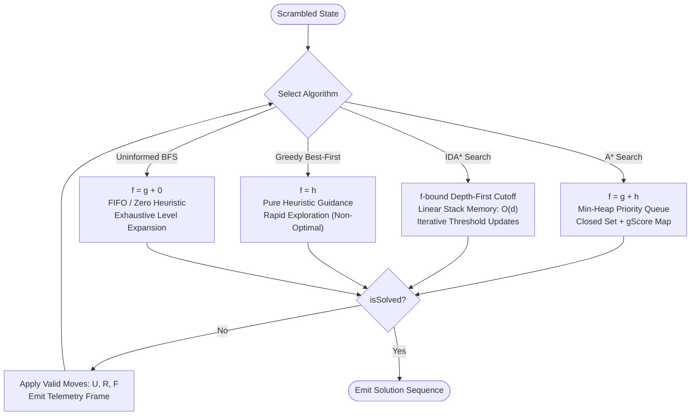
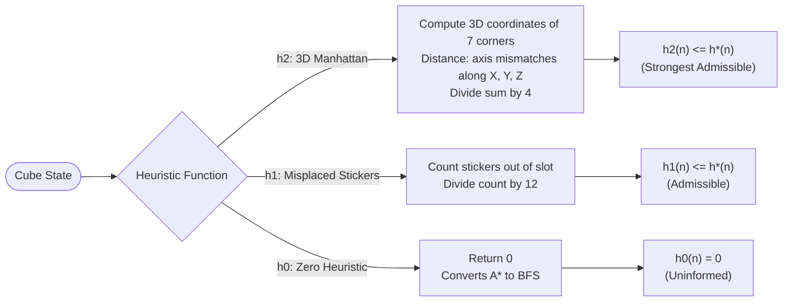

# 🧊 3D Pocket Cube (2×2) Heuristic Search Visualizer

<p align="center">
  
  
  
  
  
  
</p>

<p align="center">
  <b>An interactive 3D WebGL laboratory and academic benchmarking suite for informed heuristic search on the 2×2 Pocket Cube.</b><br/>
  Explores state-space search algorithms (<b>A*</b>, <b>IDA*</b>, <b>Greedy Best-First</b>, and <b>BFS</b>) in real time, synchronizing physical 3D cube rotations with an interactive 2D search tree canvas.
</p>

<p align="center">
  <a href="#-quick-start">Quick Start</a> •
  <a href="#-key-features">Key Features</a> •
  <a href="#-mathematical-formulation">Mathematical Formulation</a> •
  <a href="#-heuristic-search-algorithms">Search Algorithms</a> •
  <a href="#-heuristics--admissibility-proofs">Heuristic Proofs</a> •
  <a href="#-software-architecture">Architecture</a> •
  <a href="#-verification-test-gates">Test Gates</a> •
  <a href="#-keyboard-shortcuts">Controls</a>
</p>

---

## ⚡ Highlights

* 🎮 **Interactive 3D WebGL Studio** — Photorealistic 2×2 Pocket Cube built with Three.js, complete with studio lighting, micro-beveled cubies, glossy decals, and drift-free pivot-group rotation mechanics.
* 🧠 **Real-Time Heuristic Search** — Watch **A\***, **IDA\***, and **Greedy Best-First Search** traverse millions of permutations using admissible heuristics ($h_2$ Manhattan distance, $h_1$ misplaced stickers, and $h_0$ BFS).
* 🌳 **Interactive 2D Search Tree** — Real-time high-DPI HTML5 Canvas rendering of the expansion graph. Click any node badge in the graph to preview that exact configuration on the 3D cube!
* ⏱ **Non-Blocking Telemetry Generator** — Asynchronous ES6 generator architecture emits node-by-node search metrics without freezing the browser thread, supporting both **Instant** and **Live Search** throttling.
* 📐 **Group Theory & Symmetry Reduction** — Pins the Down-Back-Left (DBL) corner piece to eliminate whole-cube rotational symmetries, pruning branching factor and guaranteeing canonical representations.
* 🛡 **Automated 3-Gate Test Suite** — Headless Node.js unit tests verifying permutation group theory, heuristic admissibility bounds, solver optimality, and 3D mesh synchronization.

---

## 🚀 Quick Start

### Prerequisites
* **Node.js** `v18.17.0` or higher (`v20+` recommended)
* **npm** `v9.0.0` or higher

```bash
# 1. Clone the repository
git clone https://github.com/your-username/RubiksCubeSolver.git
cd RubiksCubeSolver

# 2. Install dependencies
npm install

# 3. Launch local development server
npm run dev
```

Open your browser and navigate to **`http://localhost:3000`**.

### Production Build

```bash
# Compile optimized Next.js bundle
npm run build

# Start production server
npm run start
```

---

## 🎮 Key Features

| Feature | Description |
| :--- | :--- |
| **Interactive 3D Stage** | OrbitControls with free rotation, panning, smooth zoom, and one-click camera angle presets (**Iso**, **Front**, **Top**, **Right**). |
| **Face Controls** | Quick manual buttons for Clockwise (90°), Counter-Clockwise (-90°), and Half Turns (180°) on the three active faces: **U**, **R**, and **F**. |
| **Scramble Engine** | Instant scrambles for 4, 7, or 10 moves, +5 / +10 move extensions, or custom Singmaster notation input (e.g. `U R2 F' U' R`). |
| **Search Tree Canvas** | Layered hierarchy displaying expanded closed-set nodes, open frontier nodes, current search head, and final optimal solution path. |
| **Live Telemetry Cards** | Real-time tracking of Expanded Nodes ($|closed|$), Frontier Nodes ($|open|$), Depth $g(n)$, Heuristic $h(n)$, Priority $f(n)$, and Effective Branching Factor ($b^* = N^{1/d}$). |
| **Interactive Move Tape** | Ribbon sequence of the computed solution. Click any move chip to step through and preview the intermediate cube state in 3D. |
| **Speed Controller** | Adjustable search playback rate from **0.25×** (slow-motion step inspection) up to **10×** (high-speed expansion). |

---

## 📐 Mathematical Formulation

The 2×2×2 Rubik's Cube (Pocket Cube) is composed of 8 corner cubies with no edge or fixed center pieces. Each cubie exposes 3 colored stickers, totaling `8 × 3 = 24` visible facets.

### State-Space Complexity

* **Permutations:** 8 corner positions can be permuted in $8! = 40,320$ ways.
* **Orientations:** Each corner has 3 possible orientations ($0^\circ, 120^\circ, 240^\circ$). The orientation of the final piece is determined by the remaining 7, yielding $3^7 = 2,187$ orientations.
* **Physical Reachable States:**
  $$\frac{8! \times 3^7}{24} = 7! \times 3^6 = 3,674,160 \text{ states}$$
* **God's Number:**
  * **Half-Turn Metric (HTM):** **11 moves** maximum for any solvable configuration.
  * **Quarter-Turn Metric (QTM):** **14 moves** maximum.

### Symmetry Reduction (The Fixed DBL Corner)

In an unconstrained cube, whole-cube rotations (rotational symmetries of the octahedral group $O$, order 24) generate duplicate states that represent identical physical configurations viewed from different angles.

To eliminate this redundancy without requiring quotient-space graph hashing:
1. The **Down-Back-Left (DBL)** corner piece (Index 7) is locked in space.
2. Moves are strictly restricted to the 3 faces opposite and adjacent to DBL:
   $$\text{Action Space } \mathcal{A} = \{ \text{U, U', U2, R, R', R2, F, F', F2} \}$$
3. Restricting turning faces to **Up (U)**, **Right (R)**, and **Front (F)** guarantees that the DBL corner never moves.
4. This locks spatial orientation, slashes the branching factor from 18 to 9 (or 6 non-repeating), and ensures every state has a unique canonical representation.

```text
                  ┌───────┬───────┐
                  │ 0 (U) │ 1 (U) │
                  ├───────┼───────┤
                  │ 2 (U) │ 3 (U) │
          ┌───────┼───────┼───────┼───────┬───────┬───────┐
          │ 16(L) │ 17(L) │ 8 (F) │ 9 (F) │ 4 (R) │ 5 (R) │
          ├───────┼───────┼───────┼───────┼───────┼───────┤
          │ 18(L) │ 19(L) │ 10(F) │ 11(F) │ 6 (R) │ 7 (R) │
          └───────┼───────┼───────┼───────┼───────┼───────┘
                  │ 12(D) │ 13(D) │
                  ├───────┼───────┤
                  │ 14(D) │ 15(D) │
                  └───────┴───────┘
                     (Back: 20-23)
```

### 24-Sticker Representation & Permutation Cycles

The cube state is stored as a contiguous 24-element byte array (`Uint8Array(24)` or `Array(24)`):

| Face ID | Face Name | Color | Solved Slot Indices |
| :---: | :---: | :---: | :---: |
| `0` | **U** (Up) | White (`#f8fafc`) | `[0, 1, 2, 3]` |
| `1` | **R** (Right) | Red (`#ef4444`) | `[4, 5, 6, 7]` |
| `2` | **F** (Front) | Green (`#22c55e`) | `[8, 9, 10, 11]` |
| `3` | **D** (Down) | Yellow (`#facc15`) | `[12, 13, 14, 15]` |
| `4` | **L** (Left) | Orange (`#f97316`) | `[16, 17, 18, 19]` |
| `5` | **B** (Back) | Blue (`#3b82f6`) | `[20, 21, 22, 23]` |

The 8 corner cubies correspond to sticker index triplets:
- `0 (UFL)`: `[2, 8, 17]`
- `1 (UFR)`: `[3, 9, 4]`
- `2 (UBR)`: `[1, 5, 20]`
- `3 (UBL)`: `[0, 21, 16]`
- `4 (DFL)`: `[12, 19, 10]`
- `5 (DFR)`: `[13, 11, 6]`
- `6 (DBR)`: `[15, 7, 22]`
- `7 (DBL)`: `[14, 23, 18]` *(Fixed anchor)*

Transitions are computed via precomputed cyclic permutations:
- **`U` (CW quarter turn):** `[[0, 1, 3, 2], [8, 16, 20, 4], [17, 21, 5, 9]]`
- **`R` (CW quarter turn):** `[[4, 5, 7, 6], [3, 20, 15, 11], [9, 1, 22, 13]]`
- **`F` (CW quarter turn):** `[[8, 9, 11, 10], [2, 4, 13, 19], [3, 6, 12, 17]]`

Double turns (`U2`, `R2`, `F2`) compose the permutation twice; inverse turns (`U'`, `R'`, `F'`) compose it three times.

---

## 🧠 Heuristic Search Algorithms



### 1. A* Search (Optimal Graph Search)
* **Evaluation Function:**
  $$f(n) = g(n) + h(n)$$
  where $g(n)$ is the exact path cost (move count from root) and $h(n)$ is an admissible heuristic estimate to the goal.
* **Data Structures:** Custom binary `MinHeap` ordered by $f(n)$ ascending (tie-broken by deeper $g(n)$ and lower $h(n)$), `Set<string>` closed set, and `Map<string, number>` $g$-score lookup.
* **Guarantees:** Always finds the **strictly shortest (optimal) move sequence** when paired with an admissible heuristic.

### 2. IDA* (Iterative Deepening A*)
* **Mechanism:** Combines the linear memory efficiency of Depth-First Search with the optimality guarantees of A*.
* **Algorithm Flow:**
  1. Initializes threshold $T = h(\text{start})$.
  2. Traverses depth-first along active paths; prunes any branch where $f(n) = g(n) + h(n) > T$, recording the minimum exceeded value $\min f_{\text{exceeded}}$.
  3. Cycle detection along the path stack prevents infinite loops.
  4. If goal is not reached, updates $T \leftarrow \min f_{\text{exceeded}}$ and re-traverses.
* **Space Complexity:** $O(d)$ where $d$ is solution depth, bypassing the large heap footprint of standard A*.

### 3. Greedy Best-First Search
* **Evaluation Function:**
  $$f(n) = h(n)$$
* **Characteristics:** Prioritizes nodes estimated to be closest to the goal regardless of accumulated steps. Extremely fast exploration on simple scrambles, but **sacrifices optimality** (may produce longer move sequences with redundant loops).

### 4. Breadth-First Search (BFS / Uninformed Search)
* **Evaluation Function:**
  $$f(n) = g(n) + 0$$
* Implemented by selecting $h_0$ (Zero Heuristic). Expands states strictly layer-by-layer, demonstrating exponential node explosion without heuristic guidance.

### Algorithm Comparison Matrix

| Algorithm | Evaluation $f(n)$ | Space Complexity | Time Complexity | Optimality | Best Use Case |
| :--- | :---: | :---: | :---: | :---: | :--- |
| **A\*** | $g(n) + h(n)$ | $O(b^d)$ | $O(b^d)$ | **Guaranteed** | Optimal path benchmark; moderate depths |
| **IDA\*** | $g(n) + h(n) \le T$ | $O(d)$ | $O(b^d)$ | **Guaranteed** | Memory-constrained optimal search |
| **Greedy Best-FS** | $h(n)$ | $O(b^d)$ | $O(b^m)$ | Suboptimal | Rapid heuristic exploration |
| **BFS ($h_0$)** | $g(n)$ | $O(b^d)$ | $O(b^d)$ | **Guaranteed** | Uninformed baseline comparison |

---

## 🔬 Heuristics & Admissibility Proofs

> [!NOTE]
> A heuristic $h(n)$ is **admissible** if it never overestimates the true cost $h^*(n)$ to reach the solved state:
> $$0 \le h(n) \le h^*(n) \quad \forall n$$



### 1. 3D Manhattan Corner Distance ($h_2$)
The most informed and powerful heuristic in the engine.
1. Each of the 7 movable corner cubies is identified by its color triplet, mapping it to its target home position $p \in \{0, \dots, 6\}$.
2. The current coordinates $c_{\text{curr}} \in \{-1, +1\}^3$ and target coordinates $c_{\text{home}} \in \{-1, +1\}^3$ are compared across the Cartesian axes $X, Y, Z$.
3. The number of axis mismatches ($0, 1, 2, 3$) gives the minimum turns needed to reposition that single corner:
   $$\text{cost}(p) = \begin{cases} 0 & \text{if mismatches} = 0 \\ 1 & \text{if mismatches} \in \{1, 2\} \\ 2 & \text{if mismatches} = 3 \end{cases}$$
4. **Admissibility Proof:** Any single quarter or half turn moves at most **4 corners** simultaneously. Therefore, no single turn can decrease the total corner distance sum by more than 4. Dividing the sum by 4 guarantees admissibility:
   $$h_2(n) = \frac{1}{4} \sum_{p=0}^6 \text{cost}(p) \le h^*(n)$$

### 2. Misplaced Sticker Heuristic ($h_1$)
1. Counts the number of stickers out of 24 that do not match their target face color:
   $$\text{misplaced}(n) = \sum_{i=0}^{23} [\text{state}[i] \ne \text{targetFace}[i]]$$
2. **Admissibility Proof:** Any face turn rotates 4 stickers on the turned face and cycles $2 \times 4 = 8$ side stickers, affecting at most **12 stickers**. Hence, no move can fix more than 12 stickers:
   $$h_1(n) = \frac{\text{misplaced}(n)}{12} \le h^*(n)$$

### 3. Corner Position & Twist Heuristic ($h_{\text{cubie}}$)
Counts how many of the 7 movable corners are either in the wrong position slot or correctly positioned but twisted, divided by 4:
$$h_{\text{cubie}}(n) = \frac{\text{unsolvedCorners}(n)}{4}$$

### 4. Zero Heuristic ($h_0$)
Returns constant 0 ($h_0(n) = 0$), transforming A* into Breadth-First Search / Dijkstra's Algorithm.

---

## 🏗 Software Architecture

```text
┌────────────────────────────────────────────────────────────────────────┐
│                          Next.js 16 / React 19                         │
│                                                                        │
│   ┌────────────────────┐   Settings / Controls   ┌─────────────────┐   │
│   │   ConfigPanel.jsx  │ ──────────────────────> │ useCubeStudio.js│   │
│   │   ActionBar.jsx    │                         │  (Custom Hook)  │   │
│   │   FaceControls.jsx │                         └────────┬────────┘   │
│   └────────────────────┘                                  │            │
│                                           Dispatches / Coordinates     │
│                                                           │            │
│            ┌──────────────────────────────────────────────┼──────────┐ │
│            ▼                                              ▼          ▼ │
│  ┌───────────────────┐    Telemetry Frames     ┌───────────────────┐   │
│  │ SearchEngine.js   │ ──────────────────────> │SearchTreeCanvas.js│   │
│  │ (Async Generator) │                         │  (HTML5 2D Canvas)│   │
│  └─────────┬─────────┘                         └───────────────────┘   │
│            │ State Transitions                                         │
│            ▼                                                           │
│  ┌───────────────────┐    Snaps & Rotations    ┌───────────────────┐   │
│  │   CubeState.js    │ ──────────────────────> │    CubeScene.js   │   │
│  │ (Permutation Perm)│                         │ (Three.js WebGL)  │   │
│  └───────────────────┘                         └───────────────────┘   │
└────────────────────────────────────────────────────────────────────────┘
```

### Generator-Based Telemetry Loop
Instead of blocking the browser's UI thread during multi-thousand node explorations, the solver is implemented as an ES6 **Generator**:
```javascript
export function* search(startState, options = {}) {
  // Yields rich telemetry frames at user-specified intervals
  yield buildFrame(step++, algorithmId, current, open, closed.size, isGoal);
}
```
* **Instant Mode:** Executes synchronously without UI yielding, immediately computing the solution and animating playback.
* **Live Search Mode:** Throttles generator consumption (`yieldEvery`, `sleep(ms)`), dynamically rendering candidate nodes on both the 3D cube and the 2D tree graph.

### Three.js Pivot-Group Rotation Engine
To prevent quaternion drift, rounding errors, and gimbal lock over hundreds of animated face turns:
1. A temporary `pivot = new THREE.Group()` is attached at world origin `(0, 0, 0)`.
2. The 4 cubies on the turning layer (e.g. $y > 0.1$ for Up face) are attached into `pivot` using `pivot.attach(cubie)` (preserving world matrices).
3. The pivot is smoothly animated using cubic easing (`easeInOutCubic`).
4. On completion, cubies are reparented back to the scene using `scene.attach(cubie)`.
5. Exact lattice coordinates $(\pm0.52, \pm0.52, \pm0.52)$ and rotation angles ($\frac{k\pi}{2}$) are snapped to eliminate numerical drift.

---

## 📁 Repository Structure

```text
RubiksCubeSolver/
├── package.json               # Manifest, dependencies, and test gate scripts
├── jsconfig.json              # Path aliases (@/* -> ./src/*)
├── next.config.mjs            # Next.js build configuration
│
├── src/
│   ├── app/
│   │   ├── layout.jsx         # HTML document shell, metadata, and fonts
│   │   └── page.jsx           # Entry route mounting the Studio component
│   │
│   ├── core/                  # Pure mathematical domain
│   │   ├── constants.js       # Face indices, color definitions, cycle tables
│   │   └── CubeState.js       # Permutation composition, moves, scramble generator
│   │
│   ├── solver/                # Heuristic search algorithms
│   │   ├── heuristics.js      # h2 (Manhattan), h1 (Misplaced), hCubie, h0 (BFS)
│   │   └── SearchEngine.js    # A*, IDA*, Greedy Best-FS, MinHeap, generators
│   │
│   ├── three/                 # 3D WebGL rendering engine
│   │   ├── CubeScene.js       # Renderer, studio lighting, shadow plane, camera
│   │   ├── CubieMesh.js       # RoundedBox cubies, decal extrusions, state snapping
│   │   └── MoveAnimator.js    # Pivot-group quaternion face rotation queue
│   │
│   ├── visualizer/            # 2D search tree
│   │   └── SearchTreeCanvas.js# High-DPI canvas hierarchical tree renderer
│   │
│   ├── hooks/
│   │   └── useCubeStudio.js   # Master state orchestrator (solver + scene + tree)
│   │
│   ├── components/            # React UI components
│   │   ├── Studio.jsx         # Main responsive split-view layout
│   │   ├── TopBar.jsx         # Header branding, status indicator, documentation link
│   │   ├── CubeStage.jsx      # Three.js canvas container + camera view chips
│   │   ├── FaceControls.jsx   # Manual face turn buttons (U, R, F)
│   │   ├── ConfigPanel.jsx    # Algorithm, heuristic, mode, and speed selectors
│   │   ├── ActionBar.jsx      # Scramble presets, extension buttons, custom notation
│   │   ├── MetricsPanel.jsx   # Telemetry cards (closed, open, depth, h, f, b*)
│   │   ├── MoveTapePanel.jsx  # Interactive move chip sequence with copy button
│   │   ├── SearchTreePanel.jsx# Search tree canvas wrapper + legend + reset zoom
│   │   ├── ShortcutsModal.jsx # Keyboard shortcuts cheat sheet modal
│   │   └── icons.jsx          # Lightweight SVG icon collection
│   │
│   └── styles/
│       └── main.css           # Global dark theme studio styling
│
├── test-cube.js               # Gate 1 verification: Permutation group theory
├── test-solver.js             # Gate 2 verification: Heuristics, A*, IDA*, Greedy
└── test-three.js              # Gate 3 verification: Three.js mesh sync & animator
```

---

## 🧪 Verification Test Gates

The project contains an automated 3-tier testing gate suite runnable headlessly via plain Node.js:

```bash
# Run all verification gates
npm test

# Run individual test gates
npm run test:cube     # Gate 1: State permutations & group theory invariants
npm run test:solver   # Gate 2: Heuristic admissibility & search optimality
npm run test:three    # Gate 3: Three.js math & mesh alignment
```

### What Each Gate Verifies:

* **Gate 1 (`test-cube.js`):**
  * Verifies that all corner sticker triplets match face boundaries.
  * Validates that all move transformations are bijective mappings of size 24.
  * Confirms the fixed DBL anchor corner never moves under any valid move sequence.
  * Order-of-operation invariants: $U^4 = I$, $(R\,U\,R'\,U')^6 = I$.
  * Invertibility: $M \circ M^{-1} = I$ for every move.
* **Gate 2 (`test-solver.js`):**
  * Confirms $h(\text{goal}) = 0$ and $h(s) \ge 0$ for all heuristics.
  * Rigorously asserts admissibility $h_1(s) \le h^*(s)$ and $h_2(s) \le h^*(s)$ across exhaustive depth-3 state trees.
  * Verifies strictly optimal solution lengths for A* and IDA* on random scrambles.
  * Ensures sub-500ms benchmark target is met for A* with $h_2$.
  * Validates adherence to Telemetry Frame Contract 1.2.
* **Gate 3 (`test-three.js`):**
  * 3D cubies match `CubeState.js` upon initialization.
  * Sequential animated moves via `MoveAnimator` match `CubeState` permutations 100%.
  * `syncToStateArray` accurately reflects candidate search states on the 3D model.

---

## ⌨️ Keyboard Shortcuts

| Key | Action |
| :---: | :--- |
| <kbd>Space</kbd> | Start search or stop active search |
| <kbd>Esc</kbd> | Stop search / Close open modal |
| <kbd>S</kbd> | Scramble cube (7 random non-redundant moves) |
| <kbd>R</kbd> | Reset cube to solved state |
| <kbd>U</kbd> / <kbd>Shift</kbd> + <kbd>U</kbd> | Turn Up face (Clockwise / Counter-Clockwise) |
| <kbd>Alt</kbd> + <kbd>R</kbd> | Turn Right face (Clockwise) |
| <kbd>F</kbd> / <kbd>Shift</kbd> + <kbd>F</kbd> | Turn Front face (Clockwise / Counter-Clockwise) |
| <kbd>?</kbd> | Open Keyboard Shortcuts cheat sheet |

---

## 📜 Tech Stack

* **Core Framework:** [Next.js 16](https://nextjs.org/) (App Router)
* **UI Library:** [React 19](https://react.dev/)
* **3D Graphics:** [Three.js](https://threejs.org/) (`RoundedBoxGeometry`, `OrbitControls`, `MeshPhysicalMaterial`, `RoomEnvironment`)
* **2D Canvas Graph:** Native HTML5 High-DPI 2D Canvas API
* **Algorithms:** Native ES6 JavaScript (zero external dependencies for solvers and group theory)

---

## 📄 License

This project is licensed under the **MIT License**. Created for academic research, visualization, and education in Artificial Intelligence, Graph Theory, and Heuristic Search Algorithms.
