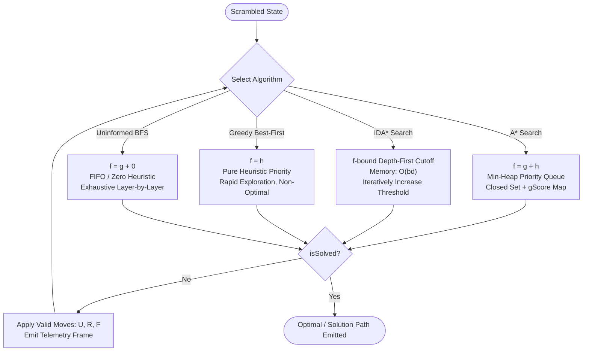
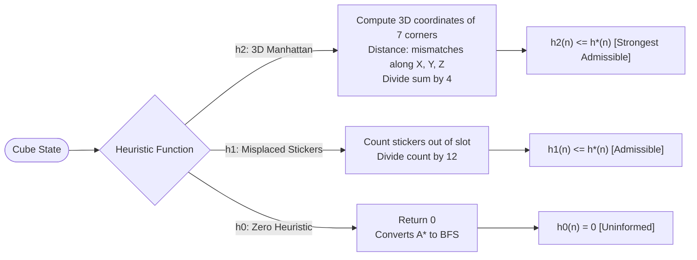

# 3D Pocket Cube (2×2) Heuristic Search Visualizer

An interactive, high-performance 3D visualizer and academic benchmarking suite for the 2×2 Pocket Cube (Rubik's Mini Cube). Built with **Next.js 16**, **React 19**, and **Three.js**, this application visually breaks down informed heuristic search algorithms (**A\***, **IDA\***, and **Greedy Best-First Search**) in real time, rendering both the physical 3D cube rotations and the underlying state-space search tree on an HTML5 canvas.

---

## Table of Contents

1. [Overview & Mathematical Formulation](#1-overview--mathematical-formulation)
   - [State-Space Complexity](#state-space-complexity)
   - [Symmetry Reduction (The Fixed DBL Corner)](#symmetry-reduction-the-fixed-dbl-corner)
   - [24-Sticker State Representation & Permutation Cycles](#24-sticker-state-representation--permutation-cycles)
2. [Heuristic Search Algorithms](#2-heuristic-search-algorithms)
   - [A* Search (Optimal Informed Graph Search)](#a-search)
   - [IDA* (Iterative Deepening A*)](#ida-iterative-deepening-a)
   - [Greedy Best-First Search](#greedy-best-first-search)
   - [Breadth-First Search (BFS / Uninformed Search)](#breadth-first-search-bfs--uninformed-search)
   - [Algorithm Comparison Matrix](#algorithm-comparison-matrix)
3. [Heuristic Functions & Admissibility](#3-heuristic-functions--admissibility)
   - [3D Manhattan Corner Distance (h2)](#3d-manhattan-corner-distance-h2)
   - [Misplaced Sticker Heuristic (h1)](#misplaced-sticker-heuristic-h1)
   - [Corner Position/Twist Heuristic (h_cubie)](#corner-positiontwist-heuristic-h_cubie)
   - [Zero Heuristic (h0)](#zero-heuristic-h0)
4. [Software Architecture & Systems Design](#4-software-architecture--systems-design)
   - [Generator-Based Search Telemetry](#generator-based-search-telemetry)
   - [Telemetry Frame Data Contract](#telemetry-frame-data-contract)
   - [Three.js 3D Engine & Pivot-Group Animator](#threejs-3d-engine--pivot-group-animator)
   - [HTML5 Canvas 2D Search Tree Visualizer](#html5-canvas-2d-search-tree-visualizer)
5. [Tech Stack](#5-tech-stack)
6. [Repository Structure](#6-repository-structure)
7. [Getting Started & Installation](#7-getting-started--installation)
8. [Testing & Verification Gates](#8-testing--verification-gates)
9. [UI & Controls Reference](#9-ui--controls-reference)
   - [Interactive Panels](#interactive-panels)
   - [Keyboard Shortcuts](#keyboard-shortcuts)

---

## 1. Overview & Mathematical Formulation

The 2×2×2 Rubik's Cube (Pocket Cube) consists of 8 corner cubies, with no edge or fixed center pieces. Each cubie exposes 3 colored stickers, yielding `8 × 3 = 24` total visible sticker facets.

### State-Space Complexity

* **Raw Permutations:** 8 corner positions can be permuted in `8! = 40,320` ways.
* **Orientations:** Each corner has 3 possible angular orientations (0°, 120°, 240°). The orientation of the final piece is uniquely determined by the other 7, giving `3^7 = 2,187` orientations.
* **Total Distinct Physical States:**
  ```text
  (8! × 3^7) / 24 = 7! × 3^6 = 3,674,160 reachable states
  ```
* **God's Number:**
  * **Half-Turn Metric (HTM):** 11 moves maximum for any solvable configuration.
  * **Quarter-Turn Metric (QTM):** 14 moves maximum.

### Symmetry Reduction (The Fixed DBL Corner)

In an unconstrained 2×2 cube, applying whole-cube rotations (rotational symmetries of the cube group `O_h`, order 24) generates duplicate states that represent identical physical configurations under different viewing angles.

To eliminate this redundancy without requiring quotient-space graph hashing:
* The **Down-Back-Left (DBL)** corner piece (Index 7) is locked in place.
* Moves are strictly restricted to the 3 faces opposite and adjacent to DBL:
  ```text
  Action Space A = { U, U', U2, R, R', R2, F, F', F2 }
  ```
* Restricting the turning faces to **Up (U)**, **Right (R)**, and **Front (F)** guarantees that the DBL corner never moves.
* This fixes spatial orientation, prunes the branching factor from 18 to 9 (or 6 non-repeating), and ensures every state has a unique canonical representation.

```text
                  ┌───────┬───────┐
                  │ 0 (U) │ 1 (U) │
                  ├───────┼───────┤
                  │ 2 (U) │ 3 (U) │
          ┌───────┼───────┼───────┼───────┬───────┬───────┐
          │ 16(L) │ 17(L) │ 8 (F) │ 9 (F) │ 4 (R) │ 5 (R) │
          ├───────┼───────┼───────┼───────┼───────┼───────┤
          │ 18(L) │ 19(L) │ 10(F) │ 11(F) │ 6 (R) │ 7 (R) │
          └───────┼───────┼───────┼───────┼───────┼───────┘
                  │ 12(D) │ 13(D) │
                  ├───────┼───────┤
                  │ 14(D) │ 15(D) │
                  └───────┴───────┘
                     (Back: 20-23)
```

### 24-Sticker State Representation & Permutation Cycles

The cube state is stored as a contiguous 24-element byte array (`Uint8Array(24)` or `Array(24)`):

| Face ID | Face Name | Color | Solved Slot Indices |
| :---: | :---: | :---: | :---: |
| `0` | **U** (Up) | White (`#f8fafc`) | `[0, 1, 2, 3]` |
| `1` | **R** (Right) | Red (`#ef4444`) | `[4, 5, 6, 7]` |
| `2` | **F** (Front) | Green (`#22c55e`) | `[8, 9, 10, 11]` |
| `3` | **D** (Down) | Yellow (`#facc15`) | `[12, 13, 14, 15]` |
| `4` | **L** (Left) | Orange (`#f97316`) | `[16, 17, 18, 19]` |
| `5` | **B** (Back) | Blue (`#3b82f6`) | `[20, 21, 22, 23]` |

The 8 corner cubies correspond to sticker index triplets:
- `0 (UFL)`: `[2, 8, 17]`
- `1 (UFR)`: `[3, 9, 4]`
- `2 (UBR)`: `[1, 5, 20]`
- `3 (UBL)`: `[0, 21, 16]`
- `4 (DFL)`: `[12, 19, 10]`
- `5 (DFR)`: `[13, 11, 6]`
- `6 (DBR)`: `[15, 7, 22]`
- `7 (DBL)`: `[14, 23, 18]` *(Fixed anchor)*

Transitions are computed via precomputed cyclic permutations:
- **`U` (CW quarter turn):** `[[0, 1, 3, 2], [8, 16, 20, 4], [17, 21, 5, 9]]`
- **`R` (CW quarter turn):** `[[4, 5, 7, 6], [3, 20, 15, 11], [9, 1, 22, 13]]`
- **`F` (CW quarter turn):** `[[8, 9, 11, 10], [2, 4, 13, 19], [3, 6, 12, 17]]`

Double turns (`U2`, `R2`, `F2`) compose the permutation twice; inverse turns (`U'`, `R'`, `F'`) compose it three times. Transition application takes `O(24)` operations using typed arrays with zero heap allocation.

---

## 2. Heuristic Search Algorithms

The engine implements four search strategies defined in `src/solver/SearchEngine.js`:



### A* Search

* **Evaluation Function:**
  ```text
  f(n) = g(n) + h(n)
  ```
  where `g(n)` is the exact cost from root to current node (number of turns) and `h(n)` is an admissible heuristic estimate to the solved state.
* **Data Structures:**
  * **Open Set:** Custom binary `MinHeap` ordered by `f(n)` ascending, tie-broken by higher `g(n)` (deeper search prioritized) and lower `h(n)`.
  * **Closed Set:** `Set<string>` of visited state hashes (`state.join(',')`).
  * **Path Map (`gScore`):** `Map<string, number>` tracking the shortest path to each visited configuration.
* **Optimality:** When paired with an admissible heuristic (`h2` or `h1`), A* guarantees an **optimal (shortest path)** solution sequence.

### IDA* (Iterative Deepening A*)

* **Mechanism:**
  Combines the linear memory efficiency of depth-first search (`O(b · d)`) with the optimality guarantees of A*.
* **Algorithm Flow:**
  1. Initialize cutoff threshold `T = h(start)`.
  2. Perform depth-first traversal using an explicit search stack.
  3. Prune any branch where `f(n) = g(n) + h(n) > T`, recording the minimum exceeded f-value (`min f_exceeded`).
  4. Cycle detection along the active search path prevents loops (`isOnCurrentPath(node, id)`).
  5. If goal is not found, update threshold `T <- min f_exceeded` and repeat.
* **Memory Complexity:** `O(d)` where `d` is the solution depth, eliminating the `O(b^d)` heap footprint of standard A*.

### Greedy Best-First Search

* **Evaluation Function:**
  ```text
  f(n) = h(n)
  ```
  Ignores accumulated step cost `g(n)` entirely.
* **Characteristics:**
  * Prioritizes nodes estimated to be closest to the goal.
  * Expands significantly fewer nodes in simple scrambles, but **sacrifices optimality**.
  * May produce solutions with redundant loops or suboptimal move counts (e.g., 12–17 moves for a 6-move scramble).
  * Serves as an academic demonstration of the speed vs. optimality trade-off.

### Breadth-First Search (BFS / Uninformed Search)

* **Evaluation Function:**
  ```text
  f(n) = g(n) + 0
  ```
* Implemented by selecting `h0` (Zero Heuristic).
* Uniformly expands nodes strictly in order of depth.
* Explores the full branching tree layer-by-layer, demonstrating exponential node explosion (`b ≈ 9`) without heuristic guidance.

### Algorithm Comparison Matrix

| Algorithm | Evaluation `f(n)` | Space Complexity | Time Complexity | Guarantees Optimality? | Typical Use Case |
| :--- | :---: | :---: | :---: | :---: | :--- |
| **A\*** | `g(n) + h(n)` | `O(b^d)` | `O(b^d)` | **Yes** (with `h` admissible) | Benchmark optimal path; moderate depths |
| **IDA\*** | `g(n) + h(n)` bound | `O(d)` | `O(b^d)` | **Yes** (with `h` admissible) | Memory-constrained optimal search |
| **Greedy Best-FS** | `h(n)` | `O(b^d)` | `O(b^m)` | **No** | Fast heuristic exploration; soft computing |
| **BFS (h0)** | `g(n)` | `O(b^d)` | `O(b^d)` | **Yes** | Baseline uninformed comparison |

---

## 3. Heuristic Functions & Admissibility

A heuristic `h(n)` is **admissible** if it never overestimates the true cost `h*(n)` to reach the goal:

```text
0 <= h(n) <= h*(n)  for all states n
```

The engine defines three selectable heuristics in `src/solver/heuristics.js`:



### 3D Manhattan Corner Distance (h2)

This is the primary and most informed admissible heuristic in the suite.

1. Each corner's unique color triplet maps to its solved home position index `p ∈ {0, ..., 7}`.
2. The current coordinates `c_current ∈ {-1, +1}³` and home coordinates `c_home ∈ {-1, +1}³` are compared across the three Cartesian axes.
3. The number of axis mismatches (0, 1, 2, or 3) determines the minimum quarter turns required to reposition that corner in isolation:
   ```text
   cost(p) = 0   if mismatches == 0
   cost(p) = 1   if mismatches in {1, 2}
   cost(p) = 2   if mismatches == 3
   ```
4. Because any single quarter or half turn moves at most **4 corners** simultaneously, dividing the sum of individual distances by 4 yields an admissible lower bound:
   ```text
   h2(n) = (1 / 4) * sum_{p=0..6} cost(p)
   ```
5. **Admissibility Proof:** A single turn can reduce the total corner distance sum by at most 4. Therefore, `h2(n) <= h*(n)` for all states.

### Misplaced Sticker Heuristic (h1)

1. Counts the number of stickers out of 24 that do not match their target face color:
   ```text
   misplaced(n) = sum_{i=0..23} (state[i] != targetFace[i] ? 1 : 0)
   ```
2. A single face turn rotates 4 stickers on the face and permutes `2 × 4 = 8` side stickers, affecting at most **12 stickers** total.
3. Dividing by 12 gives an admissible bound:
   ```text
   h1(n) = misplaced(n) / 12
   ```
4. **Admissibility Proof:** Since no single move can fix more than 12 stickers, `h1(n) <= h*(n)`.

### Corner Position/Twist Heuristic (h_cubie)

Counts how many of the 7 movable corners are either in the wrong position slot or correctly positioned but twisted, divided by 4:
```text
h_cubie(n) = unsolvedCorners(n) / 4
```

### Zero Heuristic (h0)

Returns constant 0:
```text
h0(n) = 0
```
Transforms A* into Dijkstra's Algorithm / Breadth-First Search.

---

## 4. Software Architecture & Systems Design

The application is structured into decoupled modules separating mathematical representation, solver execution, 3D WebGL rendering, 2D canvas visualization, and React UI state.

```text
┌────────────────────────────────────────────────────────────────────────┐
│                          Next.js 16 / React 19                         │
│                                                                        │
│   ┌────────────────────┐   Settings / Controls   ┌─────────────────┐   │
│   │   ConfigPanel.jsx  │ ──────────────────────> │ useCubeStudio.js│   │
│   │   ActionBar.jsx    │                         │  (Custom Hook)  │   │
│   │   FaceControls.jsx │                         └────────┬────────┘   │
│   └────────────────────┘                                  │            │
│                                           Dispatches / Coordinates     │
│                                                           │            │
│            ┌──────────────────────────────────────────────┼──────────┐ │
│            ▼                                              ▼          ▼ │
│  ┌───────────────────┐    Telemetry Frames     ┌───────────────────┐   │
│  │ SearchEngine.js   │ ──────────────────────> │SearchTreeCanvas.js│   │
│  │ (Async Generator) │                         │  (HTML5 2D Canvas)│   │
│  └─────────┬─────────┘                         └───────────────────┘   │
│            │ State Transitions                                         │
│            ▼                                                           │
│  ┌───────────────────┐    Snaps & Rotations    ┌───────────────────┐   │
│  │   CubeState.js    │ ──────────────────────> │    CubeScene.js   │   │
│  │ (Permutation Perm)│                         │ (Three.js WebGL)  │   │
│  └───────────────────┘                         └───────────────────┘   │
└────────────────────────────────────────────────────────────────────────┘
```

### Generator-Based Search Telemetry

Instead of blocking the browser's main thread during large graph traversals, the solver in `src/solver/SearchEngine.js` is implemented as an ES6 **Generator Function**:

```javascript
export function* search(startState, options = {}) {
  // Yields telemetry frames at specified intervals:
  yield buildFrame(step++, algorithmId, current, open, closed.size, isGoal);
}
```

This yields search execution control back to the UI loop, enabling:
- **Instant Mode:** Executes synchronously without UI yielding, collecting telemetry frames and executing the solution animation.
- **Live Search Mode:** Throttles generator consumption (`yieldEvery`, `sleep(ms)`), dynamically rendering each expanded candidate node on both the 3D cube and the 2D tree graph.

### Telemetry Frame Data Contract

Every yielded frame adheres to a shared contract:

```typescript
interface TelemetryFrame {
  step: number;
  algorithm: 'A*' | 'IDA*' | 'Greedy Best-First';
  currentNode: {
    id: string;              // State hash, e.g. "0,0,0,0,1,1,..."
    parentId: string | null;  // Parent node hash
    moveFromParent: string;   // Move taken ("U", "R'", "F2", etc.)
    path: string[];          // Complete sequence from root to node
    state: number[];         // 24-element state array
    g: number;               // Path depth
    h: number;               // Heuristic estimate
    f: number;               // Evaluation priority (g + h or h)
  };
  openSetCount: number;      // Frontier size
  closedSetCount: number;    // Expanded nodes count
  openTopNodes: Array<{
    id: string;
    move: string;
    g: number;
    h: number;
    f: number;
  }>;
  isGoal: boolean;
}
```

### Three.js 3D Engine & Pivot-Group Animator

* **Cubie Mesh Construction (`CubieMesh.js`):**
  * 8 distinct cubies built with `RoundedBoxGeometry` (beveled dark plastic ABS body).
  * Decal stickers extruded with circular corner arcs, micro-bevels, and glossy clearcoat physical materials (`MeshPhysicalMaterial`).
* **Studio Environment (`CubeScene.js`):**
  * Filmic tone mapping (`ACESFilmicToneMapping`), soft radial contact shadow plane, PMREM room reflections, and dual emissive studio softboxes.
* **The Pivot-Group Rotation Mechanism (`MoveAnimator.js`):**
  To prevent gimbal lock and numerical floating-point drift over hundreds of face rotations:
  1. A temporary `pivot = new THREE.Group()` is spawned at world origin `(0, 0, 0)`.
  2. The 4 cubies on the turning layer (e.g. `y > 0.1` for `U`) are reparented into `pivot` using `pivot.attach(cubie)` (preserving world matrices).
  3. The pivot's rotation is animated using cubic easing (`easeInOutCubic`).
  4. On completion, cubies are reparented back to the scene using `scene.attach(cubie)`.
  5. Coordinates and rotation angles are snapped to the exact lattice grid `(±0.52, ±0.52, ±0.52)` and exact multiples of `π / 2`.

### HTML5 Canvas 2D Search Tree Visualizer

Implemented in `src/visualizer/SearchTreeCanvas.js`:
* High-DPI canvas rendering (`window.devicePixelRatio`).
* Dynamic layered graph layout organizing nodes by depth `g(n)` on the Y-axis and sibling order on the X-axis.
* **Visual Semantics:**
  - **Closed Set (Expanded):** Solid slate gray badge with move label and `f = g + h`.
  - **Open Set (Frontier):** Outlined pill badge.
  - **Current Node:** Pulsing signal-amber accent ring with glow.
  - **Solution Path:** Thick emerald-green connecting edges and highlighted badge nodes.
* **Performance Optimizations:**
  - Rolling visible cap (260 active nodes) to maintain steady 60 FPS.
  - Pre-cached offscreen canvas sprites for node badges.
  - Interactive click listener allowing the user to click any node in the tree to immediately preview that state on the 3D cube.

---

## 5. Tech Stack

| Domain | Technology | Version | Purpose |
| :--- | :--- | :---: | :--- |
| **Framework** | Next.js (App Router) | `^16.4.2` | React application framework and server runtime |
| **UI Library** | React | `^19.3.1` | Declarative component UI and state management |
| **3D Graphics** | Three.js | `^0.180.0` | WebGL 3D cube rendering, lighting, materials, and camera |
| **Controls** | OrbitControls | *(Three Addons)* | Interactive orbital camera rotation, pan, and zoom |
| **Geometries** | RoundedBoxGeometry | *(Three Addons)* | Beveled plastic cubie bodies |
| **Environment** | RoomEnvironment | *(Three Addons)* | Studio HDRI-style environment reflection map |
| **2D Visualizer** | HTML5 Canvas 2D | Native Web API | Real-time state-space expansion tree rendering |
| **Algorithms** | Vanilla JavaScript (ESM) | Native | MinHeap priority queue, A*, IDA*, Greedy Best-FS |
| **Styling** | Vanilla CSS3 | Native | Custom dark-mode studio theme with CSS variables |

---

## 6. Repository Structure

```text
RubiksCube/
├── package.json               # Project manifest, scripts, and dependencies
├── jsconfig.json              # Path aliases (@/* -> ./src/*)
├── next.config.mjs            # Next.js build configuration
│
├── src/
│   ├── app/
│   │   ├── layout.jsx         # HTML shell, metadata, and font definitions
│   │   └── page.jsx           # Entry route mounting the Studio component
│   │
│   ├── core/                  # Core mathematical domain
│   │   ├── constants.js       # Face indices, color definitions, cycle tables
│   │   └── CubeState.js       # Permutation composition, moves, scramble generator
│   │
│   ├── solver/                # Heuristic search engine
│   │   ├── heuristics.js      # h2 (Manhattan), h1 (Misplaced), hCubie, h0 (BFS)
│   │   └── SearchEngine.js    # A*, IDA*, Greedy Best-FS, MinHeap, generators
│   │
│   ├── three/                 # 3D WebGL stage
│   │   ├── CubeScene.js       # Renderer, studio lighting, shadow plane, camera
│   │   ├── CubieMesh.js       # RoundedBox cubies, decal extrusions, state snapping
│   │   └── MoveAnimator.js    # Pivot-group quaternion face rotation queue
│   │
│   ├── visualizer/            # 2D search tree
│   │   └── SearchTreeCanvas.js # HTML5 Canvas hierarchical tree renderer
│   │
│   ├── hooks/
│   │   └── useCubeStudio.js   # Master state orchestrator (solver + scene + tree)
│   │
│   ├── components/            # React UI components
│   │   ├── Studio.jsx         # Main responsive split-view layout
│   │   ├── TopBar.jsx         # Header branding, status indicator, documentation link
│   │   ├── CubeStage.jsx      # Three.js canvas container + camera view chips
│   │   ├── FaceControls.jsx   # Manual face turn buttons (U, R, F)
│   │   ├── ConfigPanel.jsx    # Algorithm, heuristic, mode, and speed selectors
│   │   ├── ActionBar.jsx      # Scramble presets, extension buttons, custom notation
│   │   ├── MetricsPanel.jsx   # Telemetry cards (closed, open, depth, h, f, b*)
│   │   ├── MoveTapePanel.jsx  # Interactive move chip sequence with copy button
│   │   ├── SearchTreePanel.jsx# Search tree canvas wrapper + legend + reset zoom
│   │   ├── ShortcutsModal.jsx # Keyboard shortcuts cheat sheet
│   │   └── icons.jsx          # Lightweight SVG icon set
│   │
│   └── styles/
│       └── main.css           # Global dark theme stylesheet
│
├── test-cube.js               # Gate 1 verification: Permutation group theory
├── test-solver.js             # Gate 2 verification: Heuristics, A*, IDA*, Greedy
└── test-three.js              # Gate 3 verification: Three.js mesh sync & animator
```

---

## 7. Getting Started & Installation

### Prerequisites

* **Node.js:** `v18.17.0` or higher (Node 20+ recommended)
* **npm:** `v9.0.0` or higher

### Installation

1. Clone the repository and navigate to the project directory:
   ```bash
   git clone <repo-url>
   cd RubiksCube
   ```

2. Install dependencies:
   ```bash
   npm install
   ```

3. Launch the development server:
   ```bash
   npm run dev
   ```

4. Open your browser and navigate to:
   ```text
   http://localhost:3000
   ```

### Production Build

```bash
npm run build
npm run start
```

---

## 8. Testing & Verification Gates

The repository includes an automated, multi-tiered test suite that runs headlessly in plain Node.js:

```bash
# Run all verification gates
npm test

# Run individual test gates
npm run test:cube     # Gate 1: State permutations & group theory invariants
npm run test:solver   # Gate 2: Heuristic admissibility & search optimality
npm run test:three    # Gate 3: Three.js math & mesh alignment
```

### Verification Gate Checklist

* **Gate 1 (`test-cube.js`):**
  - Corner sticker indices match face boundaries.
  - Every move permutation is a bijective mapping of size 24.
  - The fixed DBL corner never moves under any move sequence.
  - Order-of-operation checks: `U⁴ = I`, `(R U R' U')⁶ = I`.
  - Invertibility: `M ∘ M⁻¹ = I`.
* **Gate 2 (`test-solver.js`):**
  - Heuristics are 0 on solved state and non-negative elsewhere.
  - Admissibility: `h1(s) <= h*(s)` and `h2(s) <= h*(s)` verified for all states within 3 moves.
  - Optimal solution lengths verified for A* and IDA* on 6-move scrambles.
  - Sub-500ms benchmark target met for A* with `h2`.
  - Adherence to Telemetry Frame Contract 1.2 verified.
* **Gate 3 (`test-three.js`):**
  - 3D cubies match `CubeState.js` upon initialization.
  - Sequential animated moves via `MoveAnimator` match `CubeState` permutations 100%.
  - `syncToStateArray` accurately reflects search candidate states on the 3D model.

---

## 9. UI & Controls Reference

### Interactive Panels

| Panel | Description |
| :--- | :--- |
| **Cube Stage (Left)** | Interactive 3D WebGL Pocket Cube. Drag with left mouse button to rotate camera; right-click to pan; scroll wheel to zoom. Preset view chips: **Iso**, **Front**, **Top**, **Right**. |
| **Face Controls** | Quick manual buttons for CW (90°), CCW (-90°), and Half Turns (180°) on **U**, **R**, and **F** faces. |
| **Run & Scramble** | Instant scramble buttons for **4**, **7**, or **10 moves**; **+5** / **+10** extension buttons; custom move input accepting standard Singmaster notation (e.g. `U R2 F' U'`). |
| **Config Panel** | Choose Search Algorithm (**A\***, **IDA\***, **Greedy Best-First**), Heuristic (**h2 Manhattan**, **h1 Stickers**, **h0 BFS**), Execution Mode (**Instant** vs. **Live Search**), and Speed Slider (**0.25× to 10×**). |
| **Telemetry** | Live readouts: Expanded Nodes (`|closed|`), Frontier Nodes (`|open|`), Depth `g(n)`, Heuristic `h(n)`, Evaluation `f(n)`, and Effective Branching Factor (`b* = N^(1/d)`). |
| **Move Tape** | Interactive ribbon displaying the solution path. Clicking any move chip previews that intermediate step on the 3D cube. Copy button copies the notation to clipboard. |
| **Search Tree Canvas** | 2D graph visualizing the expansion tree in real time. Click any node badge to inspect its exact cube configuration in 3D. |

### Keyboard Shortcuts

| Key | Action |
| :---: | :--- |
| <kbd>Space</kbd> | Start search or stop active search |
| <kbd>Esc</kbd> | Stop search / Close modal |
| <kbd>S</kbd> | Scramble cube (7 random non-redundant moves) |
| <kbd>R</kbd> | Reset cube to solved state |
| <kbd>U</kbd> / <kbd>Shift</kbd> + <kbd>U</kbd> | Turn Up face (Clockwise / Counter-Clockwise) |
| <kbd>Alt</kbd> + <kbd>R</kbd> | Turn Right face (Clockwise) |
| <kbd>F</kbd> / <kbd>Shift</kbd> + <kbd>F</kbd> | Turn Front face (Clockwise / Counter-Clockwise) |
| <kbd>?</kbd> | Toggle Keyboard Shortcuts cheat sheet |

---

## License

This project is licensed under the MIT License. Developed for research and educational purposes in Artificial Intelligence, Soft Computing, and Heuristic Search Algorithms.
